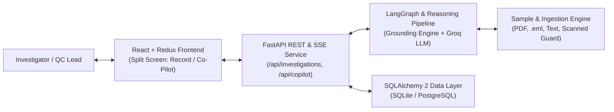
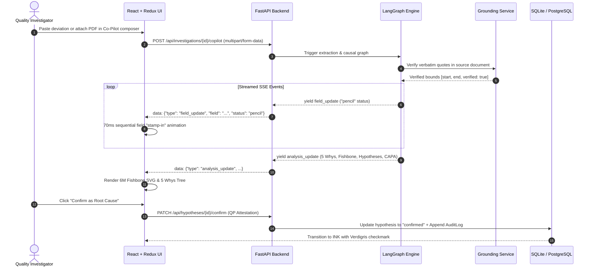
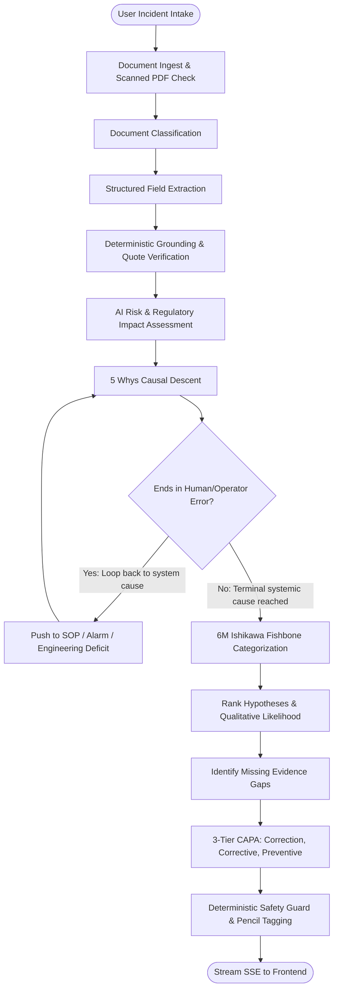

# Rootline System Architecture (docs/ARCHITECTURE.md)

## 1. Overview & System Topology

Rootline is an AI-assisted Root Cause Analysis (RCA) and CAPA recommendation module specifically engineered for Active Pharmaceutical Ingredient (API) manufacturers operating under strict cGMP regulations (ICH Q7, ICH Q9, ICH Q10, 21 CFR 211.192).

---

## 2. Request & Execution Path

---

## 3. LangGraph Workflow Architecture

---

## 4. The Pencil and Ink State Machine

Every AI-generated value follows strict regulatory immutability rules:
- `empty`: Field not present in source document. Flagged in evidence checklist, never hallucinated.
- `pencil`: Suggested by AI. Rendered with graphite color, dashed underline, and `[AI]` indicator.
- `edited`: Direct human change. Rendered with amber marker and recorded in audit log.
- `ink`: Confirmed by qualified personnel. Solid black `#15181B`, solid border, and `[✓]` verdigris stamp.

---

## 5. API Endpoints Table

| Method | Endpoint | Description | Streaming |
| :--- | :--- | :--- | :--- |
| `GET` | `/health` | Service health & active Groq models | No |
| `GET` | `/api/investigations` | List all investigations with metadata | No |
| `POST` | `/api/investigations` | Create new blank investigation | No |
| `GET` | `/api/investigations/{id}` | Full investigation record & relations | No |
| `PATCH` | `/api/investigations/{id}` | Update fields (writes audit trail) | No |
| `POST` | `/api/investigations/{id}/copilot` | **Unified Assistant Endpoint (Chat, PDF/Email intake, natural language edit)** | **Yes (SSE)** |
| `PATCH` | `/api/hypotheses/{id}/confirm` | Promote hypothesis to confirmed root cause with QP attestation | No |
| `POST` | `/api/investigations/{id}/evidence` | Submit supplemental logbook evidence & re-analyse | No |
| `PATCH` | `/api/capa/{id}` | Accept, edit, or reject proposed CAPA | No |
| `POST` | `/api/investigations/{id}/save` | Validate checklist, lock revision, bump version | No |
| `POST` | `/api/investigations/{id}/reopen` | Reopen new draft revision (vN+1) | No |
| `GET` | `/api/investigations/{id}/audit` | Append-only ALCOA+ audit log | No |
| `GET` | `/api/samples` | List available demo incident scenarios | No |

